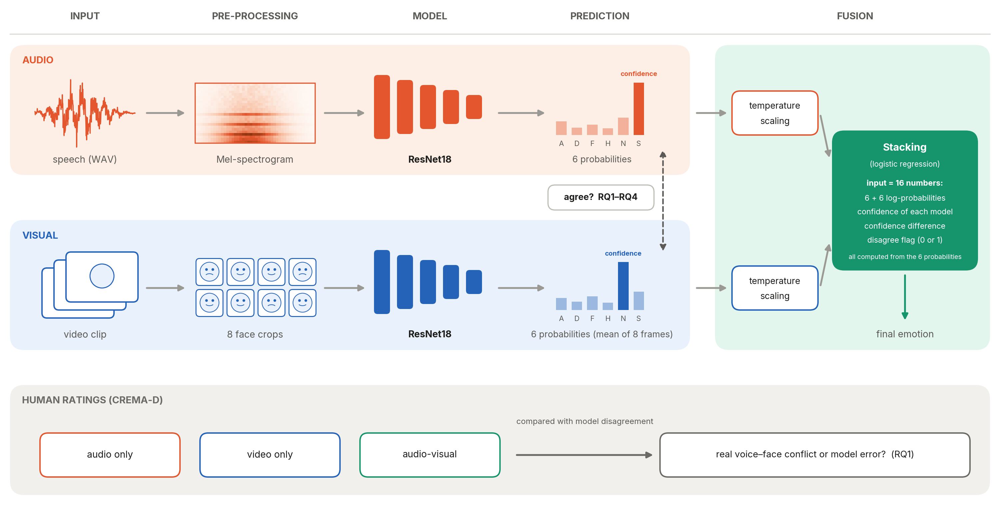
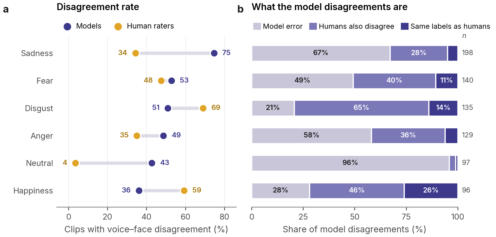
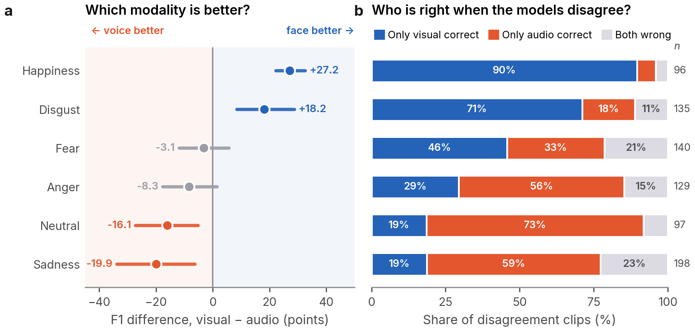
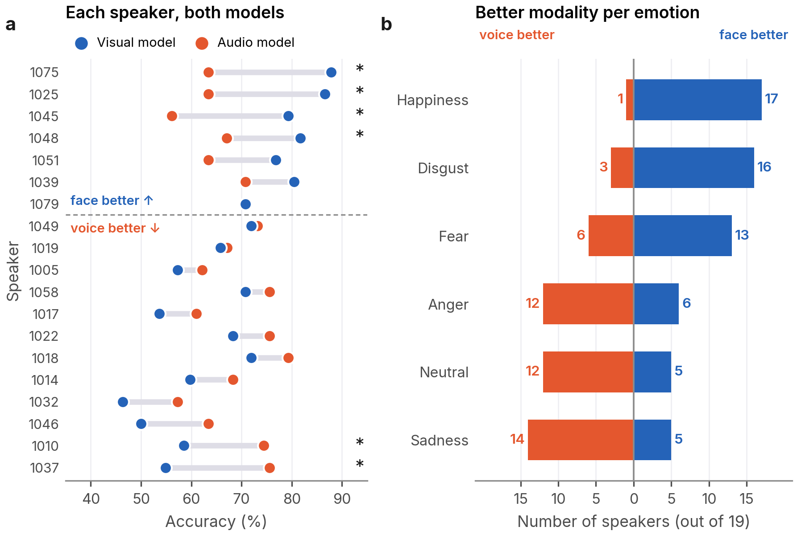
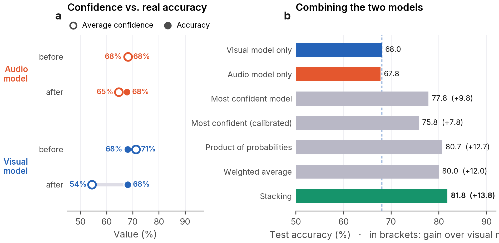

# When Voice and Face Disagree: Analysing Modality Conflict in Audio-Visual Emotion Recognition

Course project, Affective Computing, University of Oulu (Fall 2026).
Leili Motahari, Imindu Dissanayaka and Omid NoorMohammadi.

We trained two ResNet18 models on CREMA-D, one on speech Mel-spectrograms and one on
face images, and studied when and why they disagree. The report is in
[`report/Affective_Computing_Project_Report.pdf`](report/Affective_Computing_Project_Report.pdf).

**Project page:** <https://leili-m.github.io/Multimodal-Emotion-Disagreement/>

**Research questions**

| | Question | Main result |
|---|---|---|
| RQ1 | How often do the audio and visual models disagree? | On 51.2% of the test clips; 46.5% of these disagreements are also voice–face conflicts for human raters |
| RQ2 | Which emotions are harder to recognise? | Audio: disgust and sadness. Visual: sadness (F1 42.0%) |
| RQ3 | Which modality is more useful for each emotion? | Face: happiness and disgust. Voice: sadness, neutral and anger |
| RQ4 | Do speakers show emotions in different ways? | Yes; strong individual differences, not clearly explained by gender or age |
| RQ5 | Can disagreement information improve recognition? | Stacking fusion: 81.8% accuracy (visual model 68.0%, human raters 76.5%) |



## Results

Test set: 1,552 clips of 19 speakers who were not used for training.

| Method | Accuracy | Macro-F1 |
|---|---|---|
| Audio model (Mel-spectrogram, ResNet18) | 67.8% | 0.677 |
| Visual model (8 face images, ResNet18) | 68.0% | 0.673 |
| Weighted average of probabilities | 80.0% | 0.798 |
| Stacking (uses the disagreement information) | **81.8%** | **0.815** |
| Human raters, audio-visual | 76.5% | |
| Upper bound (at least one model correct) | 89.6% | |

Stacking is 13.8 percentage points better than the visual model (95% CI 9.4–17.9 over
speakers) and better than the human audio-visual ratings (McNemar, p = 1e-5).
With leave-one-speaker-out evaluation it reaches 82.0%.

**How often do the models disagree? (RQ1)**



**Which modality is more useful for each emotion? (RQ3)**



**Do speakers show emotions in different ways? (RQ4)**



**Can disagreement information improve recognition? (RQ5)**



All eight figures are in [`figures/`](figures/); the exact numbers and statistical tests
are in the notebooks in [`analysis/`](analysis/) and in the report.

## Repository structure

```
notebooks/models/   00–04  data split and model training (Google Colab, GPU)
analysis/           05–10  all results, statistics and figures of the report (CPU, seconds)
predictions/               outputs of the models (inputs of all analyses)
data/                      CREMA-D metadata and human ratings
models/                    trained model weights (checkpoints)
figures/                   the 8 figures of the report (PNG, 300 dpi)
report/                    report PDF and LaTeX source
```

## Notebooks

The notebooks contain the outputs of the original runs, so they can be read without
running them.

| Notebook | What it does | Output |
|---|---|---|
| `notebooks/models/00_data_split.ipynb` | Speaker-independent test split (20% of speakers, gender-stratified, seed 42) | `data/train.csv`, `data/test.csv` |
| `notebooks/models/01_audio_v1_baseline.ipynb` | Validation split (15 speakers), Mel-spectrogram cache, first audio model (v1) | v1 checkpoint, `predictions/audio_v1_test_predictions.csv` |
| `notebooks/models/02_audio_v1_validation_predictions.ipynb` | Predictions of v1 on the validation set | `predictions/audio_v1_validation_predictions.csv` |
| `notebooks/models/03_audio_v2_final.ipynb` | Final audio model (v2) with data augmentation | `predictions/audio_v2_*` |
| `notebooks/models/04_visual_model.ipynb` | Face detection, face cache, visual model (two training stages) | `predictions/visual_*` |
| `analysis/05_dataset_and_model_performance.ipynb` | Dataset and split (Table 1), performance of both models (Tables 3, 4, Section 3.1) | |
| `analysis/06_rq1_disagreement.ipynb` | RQ1 (Section 3.2, Tables 5, 6) | |
| `analysis/07_rq2_difficulty.ipynb` | RQ2 (Section 3.3) | |
| `analysis/08_rq3_rq4_modality_speakers.ipynb` | RQ3 and RQ4 (Sections 3.4, 3.5, Tables 7–9) | |
| `analysis/09_rq5_fusion.ipynb` | RQ5: calibration and fusion (Section 3.6, Table 10, last row of Table 6) | |
| `analysis/10_figures.ipynb` | Figures 1–8 | `figures/*.png` |

### Where each table and figure of the report comes from

| Report | Notebook |
|---|---|
| Table 1 | 05 (split itself: 00, 01) |
| Table 2 | 03 (audio), 04 (visual) |
| Tables 3, 4 | 05 |
| Tables 5, 6 | 06 (fusion row of Table 6: 09) |
| Tables 7, 8, 9 | 08 |
| Table 10 | 09 |
| Figures 1–8 | 10 (numbers of Figure 2: 03 and 04) |

## How to run

**Analyses (05–10).** No GPU needed. They only read `predictions/` and `data/`.

- Locally: `pip install -r requirements.txt`, open a notebook in `analysis/` and run all cells.
- Google Colab: copy `predictions/` and `data/` to `My Drive/Affective Project/` and run
  the notebook; it mounts Google Drive and reads the files from there.
  Notebook 10 saves the figures to `My Drive/Affective Project/figures/`.

**Models (00–04).** Google Colab with a T4 GPU. They need the CREMA-D audio (`AudioWAV`)
and video (`.flv`, folder `videos`) files in Google Drive; the paths are set in the first cells.
Re-training gives very similar but not identical results (GPU non-determinism).
To reuse our trained models instead, use the checkpoints in `models/`.

## Data

CREMA-D (Cao et al., 2014): 7,442 clips of 91 actors, six emotions.
Source: <https://github.com/CheyneyComputerScience/CREMA-D>.
The audio and video files are not included in this repository.

| File | Content | Source |
|---|---|---|
| `data/summaryTable.csv` | Emotion chosen most often by human raters (voice only, face only, audio-visual) | CREMA-D, `processedResults/summaryTable.csv` |
| `data/VideoDemographics.csv` | Age, sex, race and ethnicity of the actors | CREMA-D |
| `data/LabelDataCream.csv` | One row per clip (speaker, sentence, emotion, intensity, gender); input of notebook 00 | from CREMA-D file names and demographics |
| `data/train.csv`, `data/test.csv` | Output of notebook 00 | |

CREMA-D is available under the Open Database License (ODbL). If you use it, please cite:
H. Cao, D. G. Cooper, M. K. Keutmann, R. C. Gur, A. Nenkova and R. Verma,
"CREMA-D: Crowd-sourced Emotional Multimodal Actors Dataset", *IEEE Transactions on
Affective Computing*, 5(4):377–390, 2014.

## Prediction files

One row per clip: true label, predicted label and the six class probabilities
(`prob_Anger`, `prob_Disgust`, `prob_Fear`, `prob_Happy`, `prob_Neutral`, `prob_Sad`).
The audio and visual files are joined on the clip name (`filename` without `.wav` = `video_id`).

| File | Model | Split |
|---|---|---|
| `audio_v2_test_predictions.csv`, `audio_v2_validation_predictions.csv` | final audio model | test (1,552), validation (1,222) |
| `audio_v2_history.csv` | final audio model | training curve (40 epochs) |
| `visual_test_predictions.csv`, `visual_validation_predictions.csv` | visual model | test (1,552), validation (1,223; one clip without a face has `status = error`) |
| `audio_v1_test_predictions.csv`, `audio_v1_validation_predictions.csv` | first audio model (v1) | test, validation |

## Model weights

See [`models/README.md`](models/README.md).
